# Zor UI

Zor UI is a desktop shell for Windows 10 and 11. One small native process (`zorui.exe`, written in Rust) draws a
Material You bar with a Dynamic Island, sidebars with AI chat, an overview, a settings app, desktop widgets, a
dock, a visualizer and small animated buddies that live on your bar. Colors come from your wallpaper, and
[GlazeWM](https://github.com/glzr-io/glazewm) does the tiling.

Its look and workflow take inspiration from [end4-pC](https://github.com/pctrade/end4-pC) by pctrade, which is
based on [illogical-impulse](https://github.com/end-4/dots-hyprland) by end-4. A few parts are ported from end4-pC
(see Credits). The rest is original: the native renderer, the Dynamic Island and its AI agent status, the buddies,
the dock and the Claude usage watcher.

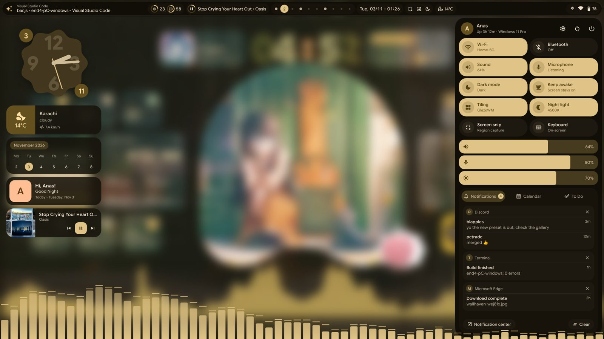

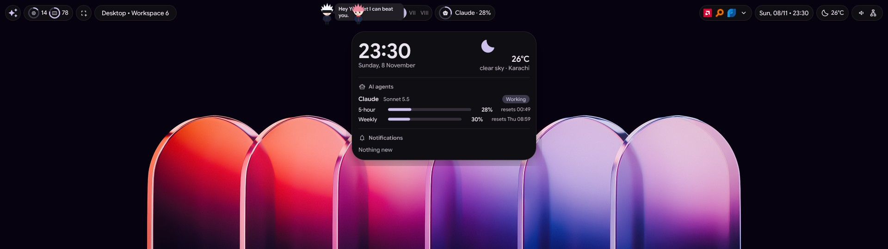

| Home | AI chat | Translator | Anime | Football |
|:---:|:---:|:---:|:---:|:---:|
| 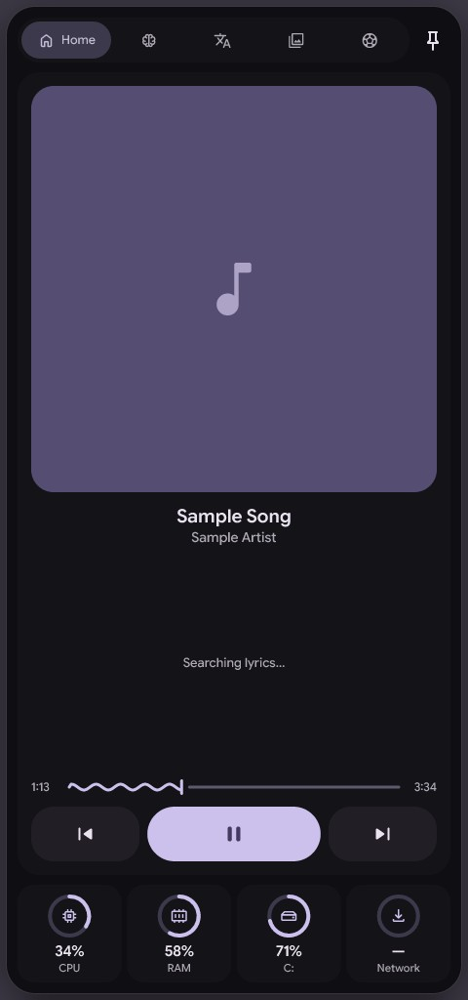 | 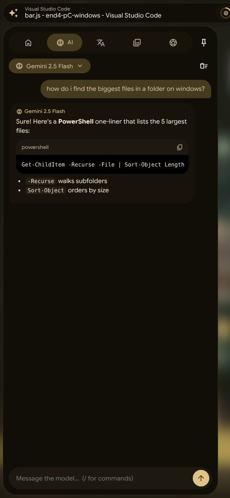 | 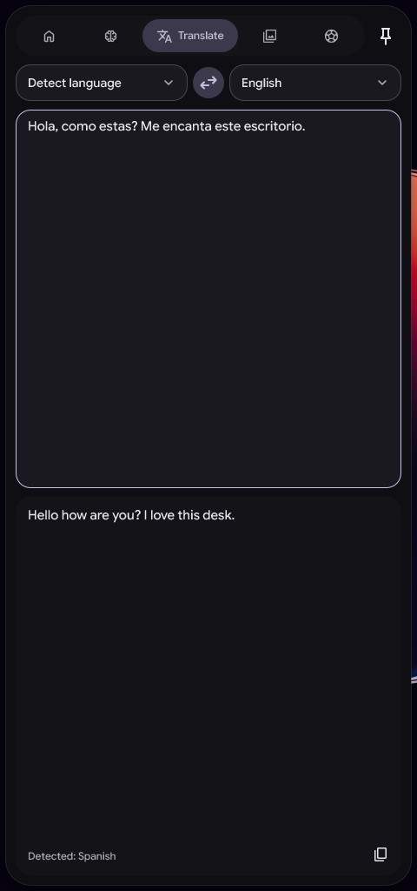 | 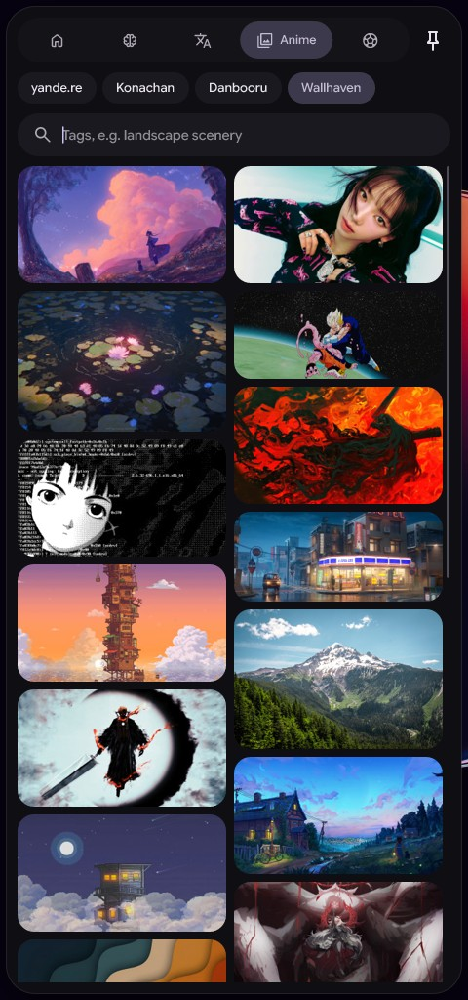 | 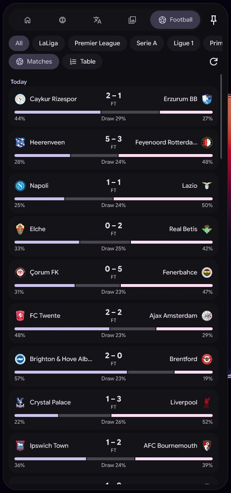 |

| Settings | Wallpaper Engine library | Presets gallery |
|:---:|:---:|:---:|
| 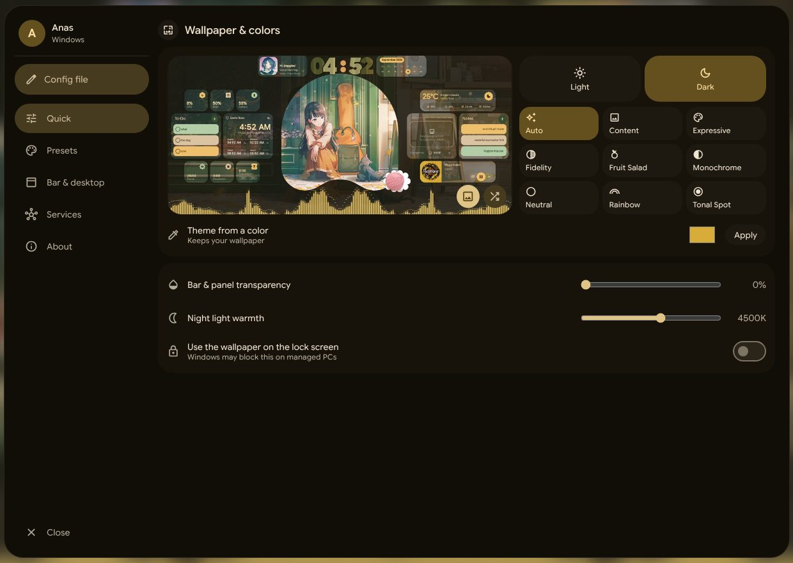 | 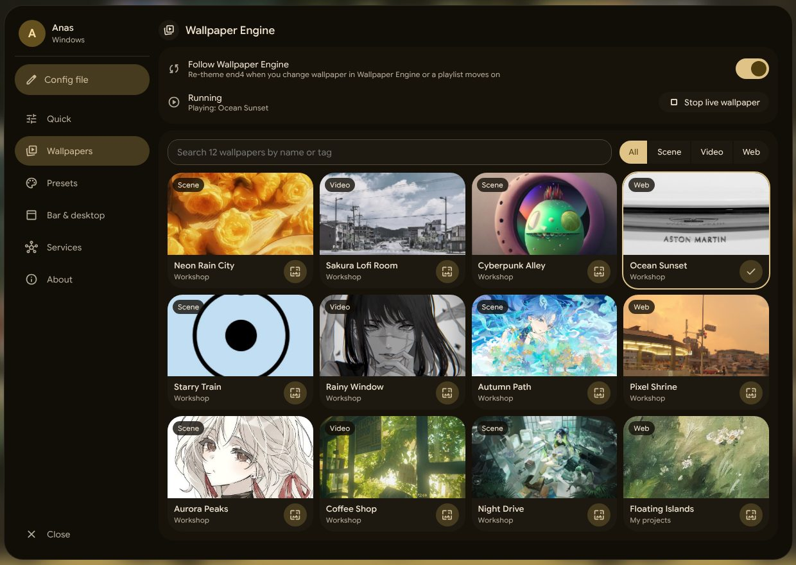 | 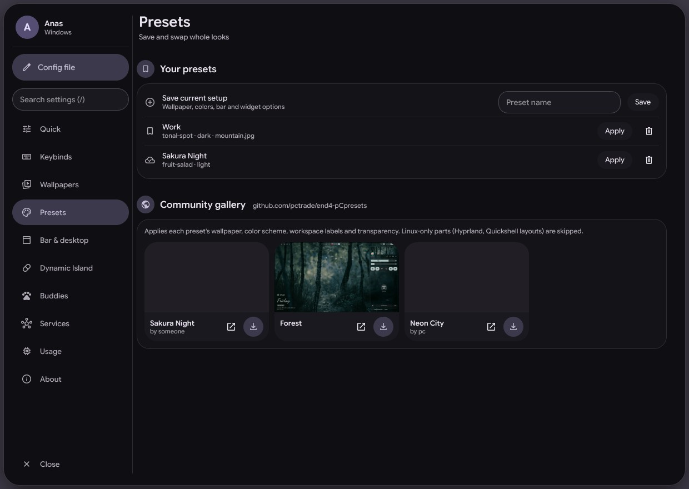 |

| Light mode | Overview |
|:---:|:---:|
| 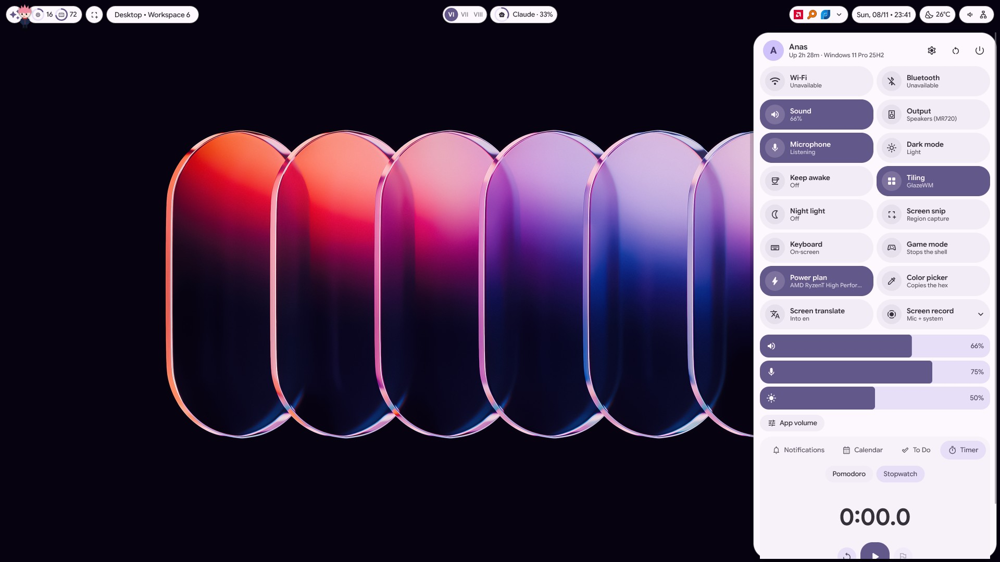 | 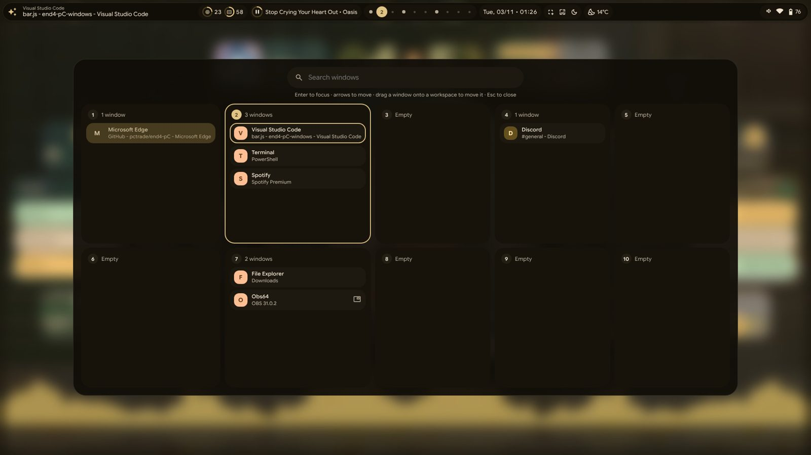 |

> The desktop, island, settings, overview and the other sidebar shots are live captures. The Home sidebar, Presets
> and Wallpapers shots are rendered from the real widget code with sample data.

## What it has

- **Bar and Dynamic Island.** Workspaces, clock, weather, system icons, tray, media and the active window, with a
  layout you can rearrange by drag and drop. The island expands for the song, timer, notifications, screen
  recording and AI agents. On a monitor covered by a full-screen window the bar hides, and the other monitor's
  bar stays.
- **AI agents in the island.** Claude Code, Codex, Gemini CLI or anything that can pipe JSON to
  `zorui.exe --agent <name>` shows up when it needs a permission or an answer, with its usage limits in the panel.
- **Sidebars.** Left: player with lyrics, AI chat (Gemini, Claude, OpenAI, Mistral, OpenRouter, Ollama, plus your
  Gemini and ChatGPT subscriptions through their CLIs), translator,
  anime and wallpaper search, football. Right: toggles, brightness and volume sliders, per-app mixer,
  notifications, calendar, to-do, pomodoro and stopwatch.
- **Buddies.** Small animated characters that walk on your bar, talk, comment on what your PC is doing and keep
  each other company. See [Buddies](#buddies).
- **Settings app.** Every option, galleries for Wallpaper Engine wallpapers and community presets, a Usage page
  with the memory and CPU of Zor UI, each of its parts and its helper programs, and an About page with a
  **Check for updates** button. Options that change how something looks show a live preview next to the control.
- **Updates and installer.** Zor UI checks GitHub for a newer release once a day and installs it, keeping your
  `config.json`. Set `"autoUpdate": false` to stop that. Releases also ship `ZorUI-Setup.exe`, a one-click
  wizard with `zorui.exe` prebuilt, so the target PC needs no Rust. It has an options page and a progress bar,
  and adds an Apps & Features entry that uninstalls Zor UI.
- **Desktop widgets, dock, overview, visualizer.** Draggable desktop cards that snap to each other, with an
  optional glass look. An auto-hiding dock, a window and clipboard overview, and an audio visualizer for the
  island, the bar and the desktop, each with its own color.
- **Theming.** Material You colors generated from your wallpaper or from a color you pick, applied to the bar,
  Windows light and dark mode, Windows Terminal and Flow Launcher.
- **Tools.** Screen recording, screen translate (OCR), color picker, night light, game mode, brightness for
  external monitors over DDC/CI, and a power plan switcher.

## Buddies

Buddies are small characters that stand on the bar, sit on its edge and on the top of open windows, sleep when you
leave, and fall back onto the bar if you drop them. Turn them on in **Settings > Buddies**.

| Setting | What it does |
|---|---|
| Show on the bar | Two slots. Buddy 1 is `"native": {"gojo": true}` in `config.json`, buddy 2 is `"buddies": {"b": {"on": true}}`. |
| Character | Gojo, Geto or Yuji. Each has its own look, lines and double-click move. |
| Name | What their partner calls them. Empty uses the character's name. |
| Talks | Quiet (no comments or chat), Normal or Chatty. |
| Walks around | Off keeps a buddy in place, sitting or standing. |
| Make them partners | With both on, they walk next to each other, face each other and trade lines. |

**What you can do to a buddy.** Hover to get their attention, click to hear a line, double-click for their move
(Gojo fires Hollow Purple), and drag to carry them. Gojo's right-click turns on Infinity, which keeps the pointer
60 px away for 10 seconds. A buddy hides behind full-screen apps.

**What they notice.** A new song, a volume or mute change, a low battery or a charger change, the network going
down or coming back, rain, snow or thunder, a new notification, and a busy CPU. With two buddies on, only buddy 1
comments on the desktop, so you don't hear every remark twice.

**Claude usage.** Gojo warns you when your Claude plan usage crosses 80% and again at 95%, whichever of the
5-hour and 7-day windows is higher. The numbers come from the same endpoint Claude Code's `/usage` reads, using the
sign-in Claude Code already stores in `~/.claude/.credentials.json`. The check runs every 3 minutes, only while a
buddy is on, and the token goes to `curl.exe` through stdin, so it never shows in the process list. If Claude Code
isn't signed in, or its token has expired, the warning stays quiet until Claude Code runs again. The endpoint is
undocumented and could change.

**Voice.** Buddies can read their lines aloud with a Windows voice. It's off by default. Add
`"gojoVoice": true` under `"native"` in `config.json` to turn it on. It uses an English Windows voice, so it doesn't
sound like any character, and each new line cuts off the one still playing.

**Buddy packs.** A folder in `~\.glzr\zor-ui\buddies\<name>\` with a `buddy.json` and your own pictures makes a
buddy that looks like any character. The folder shows up in the Character list of both slots (restart not needed, the
list refreshes every couple of seconds). **Settings > Buddies** has an "Open folder" button for the packs folder and
lists each pack with its size, or the reason a `buddy.json` can't be used. Each buddy's card starts with a preview of
how they look standing, walking and sitting with the options as they are right now, drawn by the same code as the bar.
A preview shows a picture at most 64 px tall.

```json
{
  "name": "Goku", "height": 80, "fps": 8, "base": "",
  "frames": { "stand": ["stand.png"], "walk": ["walk1.png", "walk2.png"], "sit": ["sit.png"] },
  "lines": { "greet": "Yo!", "click": ["I'm hungry.", "Wanna spar?"], "landed": "" },
  "colors": { "hair": "#101010", "eye": "#202020", "orbs": "#4fb4ff,#ff4a5a,#b060ff" },
  "moves": { "special": "beam", "alt": "none" }
}
```

- **Pictures** face right, stand with their bottom centre on the feet, and should have no empty margin. States are
  `stand`, `walk`, `sit`, `sleep`, `fall`, `held`, `point` and `talk`. Only one picture (`stand`) is needed: a buddy
  with no pictures of its own for a state stands in with the nearest one and breathes, squashes when it sits and
  pulses while it talks. File names are plain (letters, digits, space, `.`, `_`, `-`), PNG, WebP, JPG, GIF or BMP.
- **`height`** is in CSS px (16 to 160, default 52, the size of the drawn figure). On a top bar a buddy can only be
  54 px tall, because that is the room above the bar. Put the bar at the bottom or a side for a taller one.
- **`lines`** replace what a buddy says. Anything left out keeps the `base` character's line (`gojo`, `geto`, `yuji`),
  or plain neutral words when `base` is empty. A single line set to `""` makes that reaction silent. The categories
  are `greet`, `shout`, `click`, `peek`, `chat`, `right`, `to` (lines to the partner, written `"tease: Hey {p}"`,
  `invite:`, `love:` or `talk:`, each needing `{p}` for the partner's name), `reply_tease`, `reply_invite`,
  `reply_love`, `reply_talk`, and the reactions in `Say` in `cast.rs` (`held`, `teleport`, `landed`, `back`, `late`,
  `break_tips`, `focus_code`, `low_battery`, `claude_high` with `{pct}`, `note` with `{app}`, `track` with `{track}`,
  and so on).
- **`moves`** set what a double-click (`special`) and a right-click (`alt`) do. The moves are `orbs` (two orbs gather,
  meet and fire: Hollow Purple), `beam` (a ball charges at the hand and a beam shoots across), `aura` (rings and
  sparks around the body), `shield` (the pointer can't get within 60 px for 10 seconds: Infinity) and `none`. A
  move left out keeps the base's: Gojo has `orbs` and `shield`, Geto and Yuji have `orbs` and `none`, and a pack with
  no `base` has `aura` and `none`. A right-click with `none` says one of the `right` lines. `colors.orbs` is three
  colors: the two orbs and the color they merge into. A beam uses the first and the third, an aura the same.
- A pack is re-read when its `buddy.json` changes. Change a picture without touching `buddy.json` and the old one
  stays until you save the manifest or restart.
- Bring pictures you have the right to use. None are included.

**Creating a buddy without writing JSON.** **Settings > Create a buddy** turns one picture into a pack. Choose a
picture (PNG, JPG or WebP), raise **Remove background** until the backdrop is gone (it clears every pixel joined to a
corner by a similar color, like a paint bucket, and keeps anything inside the character; it is not an AI cutout, so busy
backgrounds need an editor first), cut the empty edges, mirror it if it faces left, set the height and name, pick whose
lines and double-click move it borrows, and press **Save buddy**. The preview at the top shows the exact picture that
will be saved, standing, walking and sitting. The result is `buddies\<name>\stand.png` (a compressed PNG, at most 480 px
a side) and a `buddy.json` you can edit later to add walk and sit pictures or your own lines. A second buddy with the
same name becomes `<name>-2`; nothing is ever overwritten.

The characters are drawn from shapes in `native/zor-ui/src/buddy.rs`, with palettes and lines in `cast.rs`. Gojo,
Geto and Yuji belong to their rights holders. They are here as personal fan art.

## How it is built

The first version put every widget in its own [Zebar](https://github.com/glzr-io/zebar) browser window. The bar on
two monitors plus four desktop cards used about 1 GB of memory. The native shell draws the same widgets in one
process and uses about 32 MB. Zebar, Python and the PowerShell helpers are gone.

| Part | Technology |
|---|---|
| Bar, island, sidebars, overview, settings, desktop cards, dock, visualizer, buddies | `zorui.exe` (Rust). CPU drawing with tiny-skia and DirectWrite, one layered window per widget. |
| Tiling, workspaces, keybinds | [GlazeWM](https://github.com/glzr-io/glazewm) |
| Material You colors | The same algorithm as end4's `generate_colors_material.py`, in Rust (`src/bridge/theme.rs`) |
| Helper commands (AI chat, translate, booru, football, notifications, Wallpaper Engine, media) | Rust modules in `native/zor-ui/src/bridge`, also callable from a terminal as `zorui.exe --bridge <command>`. |

Developer notes, build steps and the list of ported parts are in [native/zor-ui/README.md](native/zor-ui/README.md).

## Relation to end4-pC

end4-pC is about 100k lines of QML on **Quickshell**, which only runs on Linux and BSD, and it relies on
Hyprland, PipeWire, BlueZ, UPower, NetworkManager and MPRIS. Zor UI rebuilds the design with Windows tools:

| end4-pC on Hyprland | Zor UI on Windows |
|---|---|
| Hyprland tiling, workspaces, keybinds | [GlazeWM](https://github.com/glzr-io/glazewm) |
| Quickshell bar, sidebars, overview, settings, desktop widgets | The native `zorui.exe` |
| `switchwall.sh` | A Rust port (`zorui.exe --script switchwall`) (wallpaper, colors, Windows light and dark, lock screen picture) |
| mpvpaper live wallpapers | **Wallpaper Engine** (if installed through Steam) or [Lively Wallpaper](https://github.com/rocksdanister/lively), themed from a frame or preview |
| cava | WASAPI loopback and FFT, drawn natively |
| AI chat (Gemini, Mistral, Ollama…) | The same providers plus Claude, OpenAI and OpenRouter |
| Translator (`trans`, Google) | Google Translate |
| Anime (booru) and online wallpapers | yande.re, Konachan, Danbooru and Wallhaven |
| Football (`football.py`, ESPN) | end4's own `football.py` logic, ported |
| Notifications (Quickshell server) | Windows' notification history, shown in the right sidebar and the island |
| Night light (hyprsunset) | Gamma ramp on every display, the way f.lux does it |
| Presets (end4-pCpresets) | The same gallery: wallpaper, scheme, workspace labels and transparency get applied |
| Fuzzel / search launcher | [Flow Launcher](https://github.com/Flow-Launcher/Flow.Launcher) with a generated theme |
| Terminal colors | A Windows Terminal color scheme named `zor-ui` |
| Google Sans Flex + Material Symbols Rounded | Same fonts, bundled in `assets/fonts` |

## Install

The step-by-step guide, with requirements, Rust setup and troubleshooting, is in [docs/INSTALL.md](docs/INSTALL.md).
In short, run this in PowerShell from the folder you unzipped:

```powershell
powershell -ExecutionPolicy Bypass -File .\install.ps1
```

If you use Wallpaper Engine, that's all: Zor UI finds it in your Steam libraries. Add `-WithLively` only if you
don't have Wallpaper Engine and want video wallpapers.

| Flag | What it does |
|---|---|
| `-Mod win` | Use the Windows key like end4's Super key. The default is `alt`, because Windows reserves some Win combos (Win+L, for example). |
| `-WithLively` | Also install Lively Wallpaper, for video wallpapers without Wallpaper Engine. |
| `-HideTaskbar` | Turn on taskbar auto-hide so only the Zor UI bar shows. |
| `-Wallpaper C:\path\wall.jpg` | Image (or video) to theme from. The default is your current wallpaper. |
| `-UserName Anas` | Name shown in the greeting. |
| `-Workspaces 10` | Number of workspace dots in the bar. |
| `-SkipDeps` | Skip winget (if GlazeWM and Flow Launcher are already installed). |

The installer:
1. Installs GlazeWM, Flow Launcher, JetBrains Mono Nerd Font (and Lively with `-WithLively`) using winget.
2. Copies `zorui.exe` (prebuilt in the release, built with `cargo` from a clone) to `%LOCALAPPDATA%\zor-ui` and the fonts to `~\.glzr\zor-ui`, where `config.json` and `theme.json` also live. It moves settings out of an old `~\.glzr\zebar\zor-ui` folder, then removes Zebar (the program, its autostart entries and its folder, which is renamed to `zebar.bak-<time>`), the old widget pack and the Python environment if they are there.
3. Writes `~\.glzr\glazewm\config.yaml`. Your old config is backed up as `config.yaml.bak-<date>`.
4. Selects the Zor UI Flow Launcher theme, generates colors from your wallpaper, and starts GlazeWM, which starts the shell.

Re-running `install.ps1` updates everything and keeps your `config.json` settings. If you installed it under its old name, `end4-pC`, it moves your settings and saved state to the new `zor-ui` folders first.
`uninstall.ps1` restores the backed-up configs, turns night light off, and removes everything it added.

## Keybinds

`Mod` is Alt by default, or Win with `-Mod win`.

Every key below can be changed in Settings > Keybinds: click a key, press the new combo, Esc cancels. Zor UI handles the keys itself and sends window commands to GlazeWM, so a change works at once. Your choices are stored under `keybinds` in `config.json`.

| Keys | Action |
|---|---|
| `Mod+A` | Left sidebar: Home (player, lyrics), AI, Translator, Anime, Football |
| `Mod+N` | Right sidebar: toggles, sliders, notifications, calendar, to-do, pomodoro and stopwatch |
| `Mod+I` | Settings (colors, presets gallery, buddies, API keys, options) |
| `Mod+/` | Keybinds cheatsheet (also Settings > Keybinds) |
| ``Alt+` `` (or `Win+Tab`) | Overview |
| `Alt+Space` | Launcher (Flow Launcher) |
| `Mod+Ctrl+T` | Pick a wallpaper (image or video) and regenerate colors |
| `Mod+Ctrl+D` | Toggle dark / light |
| `Mod+Ctrl+R` | Restart the bar and reload GlazeWM |
| `Mod+Shift+G` | Game mode: stop the bar, widgets, launcher and live wallpaper to free RAM. Press again to bring them back. |
| `Mod+Enter` or `Mod+T` | Terminal |
| `Mod+E` / `Mod+W` / `Mod+C` | File Explorer / Edge / VS Code |
| `Mod+Shift+S` | Screen snip |
| `Mod+Q` / `Mod+F` / `Mod+Shift+Space` | Close / fullscreen / float |
| `Mod+1…0` / `Mod+Shift+1…0` | Go to workspace / move window there |
| `Mod+Arrows` / `Mod+Shift+Arrows` | Focus / move |
| `Mod+R` | Resize mode (arrows, Esc to leave) |

In the sidebars, `Ctrl+PageUp/PageDown` switches tabs, the pin button keeps a sidebar open, and `Esc` closes it.

## Using it

**AI chat.** Add a key once, either in Settings > Services or by typing `/key gemini YOUR_KEY` in the chat
(also `anthropic`, `openai`, `mistral` or `openrouter`). Keys are encrypted with Windows DPAPI for your
account. If [Ollama](https://ollama.com) is running, its models show up automatically. To use a subscription
instead of a key, install the CLI (`npm i -g @google/gemini-cli` for **Gemini subscription**, `npm i -g @openai/codex`
for **ChatGPT subscription**) and sign in once in a terminal. Both then appear in the model list, each using the
model its account allows. Picking one without its CLI installed shows the install command. Other commands:
`/model`, `/prompt`, `/temp`, `/clear`, `/help`.

**AI agents.** Run `zorui.exe --install-agents` to add the hooks and status line to Claude Code and the
hooks to Codex. It backs up the files it changes. After that, the island shows an agent that is waiting for you,
and the island panel shows its 5-hour and 7-day usage. Any other agent can report by piping JSON into
`zorui.exe --agent <agent>`. The format is described at the top of `native/zor-ui/src/bridge/agent_hook.rs`.

**Anime and wallpapers.** Pick a source and search by tags. Hover an image to open its post, download it
to `Pictures\Wallpapers`, or set it as your wallpaper (which also re-themes everything). Results are
safe-rated unless you turn on **Allow NSFW** in Settings > Services.

**Football.** Fixtures for the next week, live scores (refreshed every minute), win/draw/loss
probabilities and league tables. Click a match for expected goals and corners. Choose leagues in Settings.

**Timer.** The right sidebar's Timer tab has a pomodoro (25/5/15 minutes by default, set in Settings > Bar &
desktop) and a stopwatch with laps. Both keep running when the sidebar closes. While one runs, the bar shows
its time. When a pomodoro phase ends, Windows shows a notification and the bar chip turns into a reminder.

**Desktop widgets.** Settings > Bar & desktop picks the cards shown on the desktop: clock, weather, week,
greeting, media, calendar, to-do (the same list as the sidebar), notes, timer, world clock, resources, lyrics,
image cards and custom text. The clock has four styles: cookie, analog, digital and pixel. Each card is its own
window: drag it anywhere, on either monitor, and it stays there. **Reset layout** puts every card back in a
column on the left.

**Right sidebar tools.** **App volume** sets each app's volume and mute. **Screen record** records the primary
monitor to `Videos\Recordings` with the sound you choose in Settings > Services > Screen recording (none, microphone, system sound or both; both is the default); a red chip in the bar shows the time and stops it. **Screen
translate** freezes the screen: drag over some text, and Windows' OCR reads it and the translation (into the
translator's language) is drawn on top and copied. Windows only reads languages added in Settings > Time &
language > Language. **Color picker** copies the hex code of any pixel, and **Power plan** switches between
Windows' power plans. The brightness slider acts on the monitor the sidebar is on, including external monitors
that support DDC/CI.

**Bar.** Hover the clock, CPU/RAM, weather, network speed or system icons for details. When the volume or
microphone changes, the island shows the new level for a moment.

**Updates.** Settings > About shows the version and a **Check for updates** button, which looks for a newer
release right away. It downloads the release's `zorui-app.zip` and runs its `install.ps1`, which restarts the shell.

**Overview.** Type `;` (or press the paste button) to see clipboard history (`Win+V` must be turned on) and
copy an item back.

**Dock.** Settings > Bar & desktop > Dock adds a dock along the bottom: pinned apps, then every app with an open
window. Click focuses an app (again cycles its windows) or starts a pinned one; right-click pins or unpins it.
The dock appears when the pointer touches the bottom edge of its monitor, floats over windows and reserves no
screen space. It's off by default because Windows' taskbar does the same job.

**Wallpaper Engine.** Settings > Wallpapers lists everything you've subscribed to on the Workshop, plus your own
projects. Search by name or tag, filter by type, and click one to set it. Colors come from a frame for video
wallpapers and from the preview image for scenes and web wallpapers. With **Follow Wallpaper Engine** on (the
default), Zor UI also re-themes when you change wallpaper in Wallpaper Engine's own window or a playlist moves
on. **Stop live wallpaper** returns to your normal wallpaper, and so does picking an image with `Mod+Ctrl+T`.

**Theme from a color.** Settings > Colors has a color picker (saturation and value square, hue slider, hex field
and preset colors). While the picker is open the whole Settings window previews the palette that color would give.
**Apply** is what re-themes.

**Per-monitor wallpapers.** Settings > Wallpapers can give each monitor its own picture. A picture that doesn't
match a monitor's shape is cut to it around its brightest, most detailed part.

**Glass cards.** Settings > Bar & desktop > Glass cards draws each desktop card as the wallpaper behind it, blurred
and bent at the rim, with a color fringe, tint and highlight. Blur, bend, edge width, highlight, fringe, frosting,
color strength and tint each have a slider and a preview. A preset that uses glass turns it on. **Snap cards to
each other** lines a dragged card up with the edges and centers of other cards and draws guide lines (hold `Alt` to
drag freely).

**Log.** Zor UI writes one line per user action and per preset or wallpaper step to `zorui.log` in its data folder
(moved to `zorui.log.old` past 1 MB), so a silent failure can be traced afterwards.

**Presets.** Settings > Presets lists the community gallery. **Apply** downloads the preset's wallpaper and
applies its color scheme, workspace labels (for example 一 二 三), bar layout and style, desktop card positions and
pictures, and transparency. You can also save your own
setup and switch back later.

## How some of these work on Windows

- **Notifications** come from Windows' notification history, the same data Action Center shows.
  Dismissing one hides it in the sidebar. To clear it in Windows too, use **Notification center**.
- **Night light** warms the screen through the display gamma, the way f.lux does. If a display or HDR
  mode refuses it, the toggle opens Windows' own Night light settings instead.
- **Lock screen.** Windows' secure lock screen can't be replaced by another app. Instead, your wallpaper is copied
  to the Windows lock screen whenever it changes. You can turn this off in Settings, and some managed PCs block it.
- **Live wallpapers** use Wallpaper Engine's command line (`openWallpaper`, `closeWallpaper`, `getWallpaper`),
  so Zor UI works alongside it rather than replacing it. For scene and web wallpapers, only the preview image is
  available as a still, so the colors change but the Windows wallpaper and lock screen stay as they are. Without
  Wallpaper Engine, videos play in Lively. If Wallpaper Engine is installed outside your Steam libraries, set
  `wallpaperEngine.path` in `config.json`.
- **Visualizer** captures what your speakers are playing (WASAPI loopback). Apps that use exclusive mode are
  off-limits to it.

## Customize

Everything is in **Settings** (`Mod+I`). It edits `~\.glzr\zor-ui\config.json`, which you can also open
from Settings > Config file. Command-line
equivalents for theming:

- `zorui.exe --script switchwall -Scheme expressive` (also `tonal-spot`, `vibrant`, `content`, `fidelity`, `fruit-salad`, `monochrome`, `neutral`, `rainbow`, `auto`)
- `zorui.exe --script switchwall -Color '#6750A4'` themes from a color and keeps your wallpaper
- In Windows Terminal, pick the **zor-ui** color scheme once. It updates every time the colors change.

## Still not done

- end4's AI **tools**: there, the AI can run shell commands and edit the shell config. Here it only chats, on purpose.
- Uploading your own preset to the gallery. The gallery stores Linux configs, so Windows setups are saved locally instead.
- Hyprland-only settings pages (animations, decorations, monitor layout). GlazeWM's equivalents live in its `config.yaml`.
- A do-not-disturb toggle. Windows 11 has no API for it.
- Wi-Fi and Bluetooth device lists. Use the toggle's right-click, which opens Windows Settings.
- Recording sound with the screen. The recorder captures video only.
- More than two buddies, other languages for their lines, and a custom voice.
- Tray icon tooltips, and bars rebuilt after a monitor change only reserve their strip after a restart.

## Requirements and notes

- Windows 10 or 11.
- Building the native shell needs Rust. The GNU toolchain is enough.
- Voice listening downloads the sherpa-onnx speech engine (about 20 MB) from GitHub the first time you use it.

## Credits

Zor UI is its own project, but these parts come from [end4-pC](https://github.com/pctrade/end4-pC) by pctrade
(GPL-3.0, (c) end-4 / pctrade), which is based on [illogical-impulse](https://github.com/end-4/dots-hyprland) by end-4:

- `native/zor-ui/src/bridge/football.rs`, ported from `scripts/football/football.py`.
- The color generation in `native/zor-ui/src/bridge/theme/palette.rs`, adapted from
  `scripts/colors/generate_colors_material.py`.
- `native/zor-ui/src/bridge/theme.rs`, a port of end4's `switchwall.sh`.
- The football sidebar page, which follows end4-pC's `FootballPage.qml`.
- The Community gallery, which downloads presets from [end4-pCpresets](https://github.com/pctrade/end4-pCpresets).
- The default keybinds in `native/zor-ui/src/keymap.rs`, which mirror illogical-impulse on Hyprland.

## License

GPL-3.0, the same as end4-pC. Google Sans Flex is under the SIL Open Font License, and Material Symbols is under
Apache 2.0 (license files are in `assets/fonts`).
